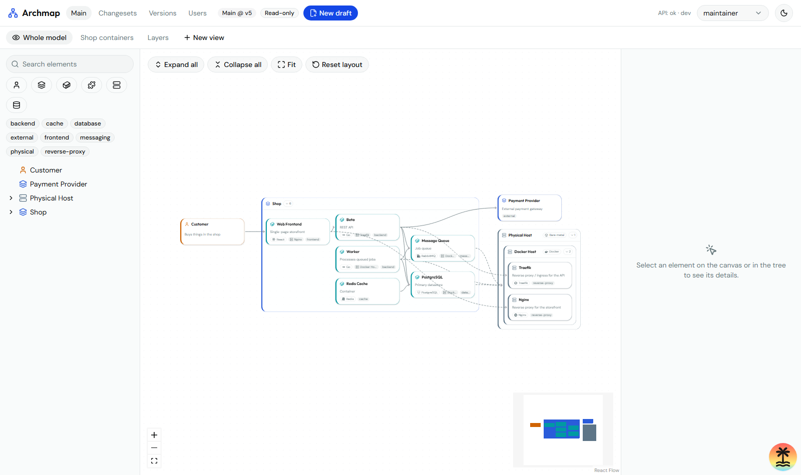
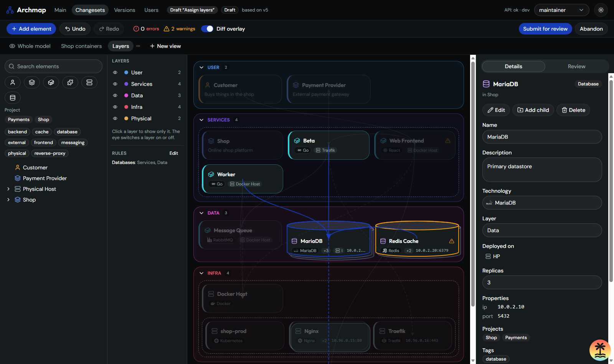
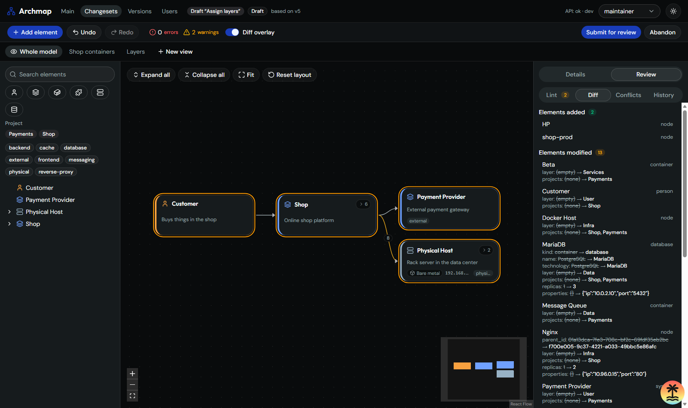
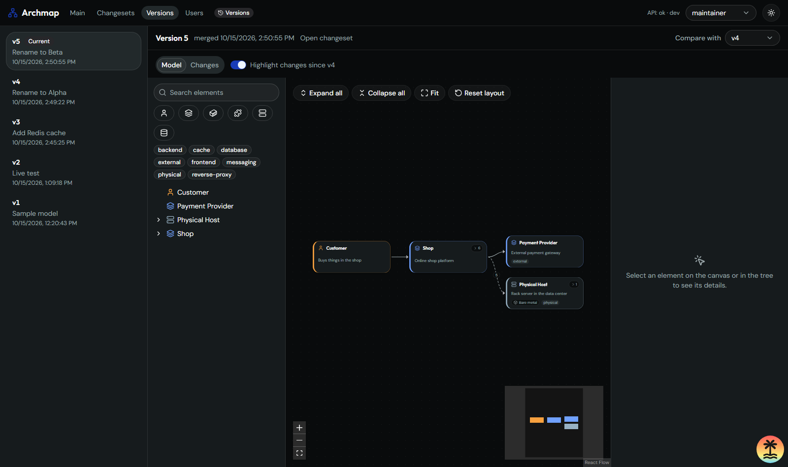
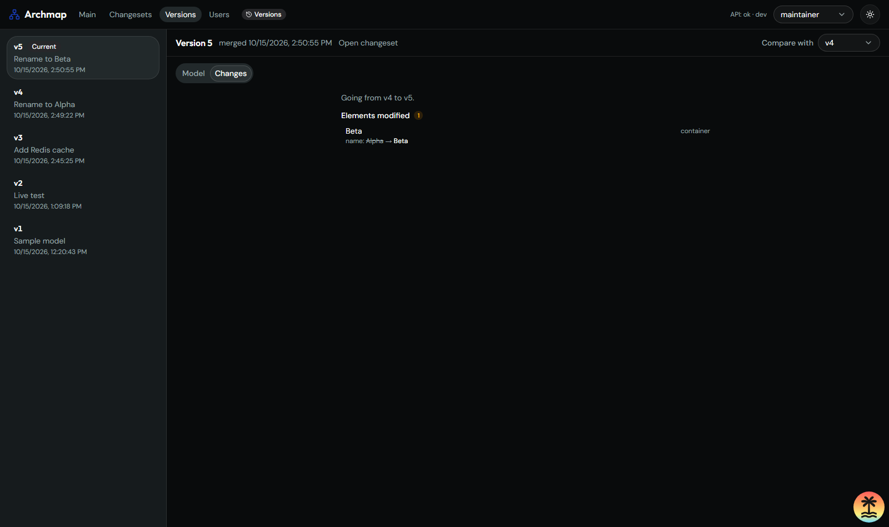

# Archmap

Collaborative, versioned system-architecture modeling. The model (people, systems, containers, components, databases and the nodes they run on) lives in one place; every edit is a **draft** that is reviewed and merged, and every merge becomes a **version** you can browse and diff.



## What it does

- **One model, many views.** Nested, zoomable C4-style canvas with ELK layout, edge aggregation, an element tree and a details panel. Saved views (scoped to an element, a kind, or a custom list) and **layers views** that stack flat plans (User, Services, Data, Infra, Physical, ...) you can browse layer by layer.
- **Everything is a changeset.** By default main is read-only; a maintainer can switch to direct editing, where every save on main is a version that can be undone (protected elements still need review). Edits (also from the right-click menu, drag & drop between layers, or the in-place editor) are recorded as changes in a draft with undo / redo. Drafts can stay open forever as temporary diagrams.
- **Review and merge.** Structured diff, lint rules (hierarchy, deployment, duplicates), field-level 3-way merge with explicit conflict resolution, protected elements that need an independent maintainer.
- **Deployment aware.** "Deployed on" is a field; cards show where something runs, nodes list what they host, databases are drawn as cylinders, replicas as stacks, and free-form properties (IP, port, namespace) are part of the model.
- **Versions.** Browse any merged version read-only and compare two versions.
- **Roles.** Viewer, editor, maintainer; maintainers manage users.

| Draft with the layers view | Reviewing a diff |
|---|---|
|  |  |

| Browsing a version | What it changed |
|---|---|
|  |  |

## Run it

Needs Go, Node with pnpm, Docker, and [go-task](https://taskfile.dev) (`scoop install task`).

```sh
cp .env.example .env        # defaults match deploy/compose/compose.yaml
pnpm install
task db-up                  # PostgreSQL 18
task migrate && task seed   # schema, dev users and a sample model (main v1)
task dev-api                # API on :8080
task dev-web                # web on :3000 (proxies /api)
```

Open <http://localhost:3000> and sign in. In development the login page offers one-click sign-in as a seeded user (`viewer@`, `editor@`, `maintainer@archmap.local`; their local password is `archmap-dev-password`). Sessions are server-side cookies; maintainers manage accounts, passwords and sign-in identities on the Users page. To create or restore a maintainer without signing in: `cd apps/api && go run ./cmd/admin ensure-maintainer -email you@example.com -name "You"` (reads the password from stdin).

Other tasks: `task test` (integration tests need Docker), `task lint`, `task gen` (regenerate server stubs, sqlc and the TypeScript client from `contracts/openapi.yaml`), `task hooks` (install the lefthook pre-commit hooks).

## Layout

| Path | What |
|---|---|
| `apps/api` | Go 1.27, Echo v5, pgx + sqlc, goose migrations; package by feature |
| `apps/web` | TanStack Start, React Flow, shadcn (Base UI), Tailwind |
| `contracts/openapi.yaml` | Source of truth for the API; code is generated from it |
| `packages/api-client` | Generated TypeScript client |
| `deploy/compose` | PostgreSQL for development |
| `docs/` | `PROJECT_BRIEF.md`, `ARCHITECTURE.md`, `DECISIONS.md` (ADRs) |

Not built yet: custom technology icon upload, single sign-on (OIDC plugs into the M7 provider interface).
